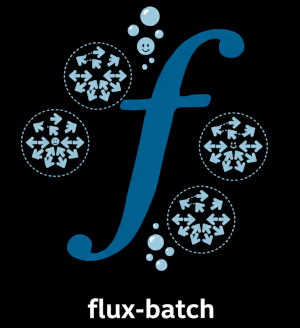

# flux-batch

> Python SDK to generate Flux batch jobs and services


[](https://converged-computing.github.io/flux-batch/)



flux-batch builds Flux batch jobs from a list of commands, wraps them with
prologs, epilogs and services, and submits them. Modules deploy something
across every node of the job before your work runs, such as a user space
Kubernetes cluster with [usernetes](https://converged-computing.github.io/flux-batch/modules/usernetes.html).

📖 **Documentation: https://converged-computing.github.io/flux-batch/**

## Quick start

Inside a Flux instance (`flux start`, or an allocation with `FLUX_URI` set; see the
[installation docs](https://converged-computing.github.io/flux-batch/getting-started/install.html)):

```bash
flux python -m pip install --user -e .
flux python my_script.py
```

```python
import flux
import flux_batch

batch = flux_batch.BatchJobV1()
batch.add_job(["echo", "hello from flux-batch"])

spec = flux_batch.BatchJobspecV1.from_jobs(batch, nodes=1, time_limit="10m")
print(flux_batch.submit(flux.Flux(), spec, dry_run=True))  # preview
jobid = flux_batch.submit(flux.Flux(), spec)
```

See the [examples](examples) directory for more.

## License

HPCIC DevTools is distributed under the terms of the MIT license.
All new contributions must be made under this license.

See [LICENSE](https://github.com/converged-computing/cloud-select/blob/main/LICENSE),
[COPYRIGHT](https://github.com/converged-computing/cloud-select/blob/main/COPYRIGHT), and
[NOTICE](https://github.com/converged-computing/cloud-select/blob/main/NOTICE) for details.

SPDX-License-Identifier: (MIT)

LLNL-CODE- 842614
